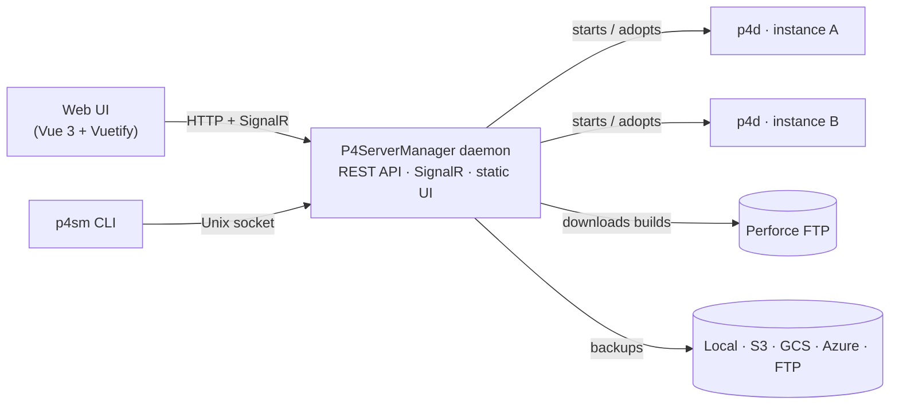

<div align="center">


# P4 Server Manager

**Create, run and maintain your Perforce P4 servers from a web UI or the command line.**

[](https://github.com/FrozenStormInteractive/P4ServerManager/actions/workflows/ci.yml)
[](https://github.com/FrozenStormInteractive/P4ServerManager/releases)
[](LICENSE.md)


</div>

> [!IMPORTANT]
> **This is an independent, community project. It is not a Perforce product**, and it is not affiliated with,
> endorsed by, or supported by Perforce Software. Read the [Disclaimer](#disclaimer) before you build or run it.

---

## Why

P4 Server Manager is a self-hosted daemon that manages any number of p4d servers on one machine, without SSH.
It replaces the [Perforce-Synology](https://github.com/FrozenStormInteractive/Perforce-Synology) package and its
SSH-only `p4dctl-ng`, which shipped with a single p4d version baked in.

- **No p4d in the package.** Each server is pinned to an exact p4d build, downloaded on demand from the Perforce FTP.
- **Safe server lifecycle management.** A crash or restart of the daemon never stops a running p4d: on startup, the daemon
  adopts the running servers instead of restarting them.
- **Safe operations first.** Upgrades, backups and restores come with checkpoints and checks.

## Features

| | |
| --- | --- |
| 🖥️ **Instances** | Create, start, stop and restart p4d servers. Change their port or server ID, switch maintenance mode, convert them to Unicode, delete them with or without their files. |
| ⬆️ **Upgrades** | Pick a p4d release per server and upgrade its database in place. |
| 📦 **p4d builds** | Download builds from the Perforce FTP, or import them from `p4d`/`p4` or `helix-core-server.tgz`. Watch chosen releases for new builds on a schedule, keep the newest ones, protect the ones you rely on. |
| 💾 **Backups** | Consistent, encrypted backups to a local folder or network share, Amazon S3, S3-compatible storage (Backblaze B2, Cloudflare R2, Wasabi…), Google Cloud Storage, Azure Blob Storage or FTP(S). Restore a backup point in place, or create a new server from it. |
| 🩺 **Health checks** | Check the database of a server and keep the reports. |
| 🔑 **Super users** | The daemon keeps the super user of each server to administer it, its password encrypted at rest, and checks it periodically. |
| 👥 **Accounts** | Sign-in for the web UI and the API, with administrators and regular users. |
| 📥 **Migration** | Import the p4dctl-ng profiles of the former HelixCoreServer Synology package, keeping their root. |
| ⚡ **Live updates** | The web UI follows operations in real time through SignalR. |

## Installation

Prebuilt packages are attached to each [GitHub release](https://github.com/FrozenStormInteractive/P4ServerManager/releases).
They are self-contained: no .NET runtime to install. Perforce publishes no 32-bit ARM p4d, so there is no 32-bit
ARM build.

### Synology NAS

Requires **DSM 7.2 or later** on an `x86_64` or `armv8` (64-bit ARM) NAS.

1. Download `P4ServerManager-<arch>-<version>-<build>.spk` from the latest release.
2. In **Package Center**, choose **Manual Install** and pick the file.
3. Follow the wizard. It can create the first administrator account.
4. Open **P4 Server Manager** from the DSM main menu, or browse to `http://<nas>:8666`.

The package runs as the `Perforce` user and stores the P4 servers in the `P4ServerManager` shared folder.
[packaging/spk/README.md](packaging/spk/README.md) describes where everything lives, how accounts work and what to
back up.

> [!WARNING]
> The UI port serves plain HTTP. Outside a trusted network, put it behind HTTPS, for instance with the DSM reverse
> proxy (with the WebSocket headers).

### Linux

Download `P4ServerManager-<rid>-<version>.zip` (`linux-x64` or `linux-arm64`) from the latest release. The archive
holds the daemon, with its web UI, and the `p4sm` CLI. The daemon can run as a systemd service; the CLI then looks
for its socket at `/run/p4servermanager/daemon.sock`.

## Usage

### Web UI

Open the UI port in a browser and sign in. The first visit asks you to create the administrator account if none
exists yet. From there you can download p4d builds, create servers, set up backup destinations and follow every
operation live.

### Command line

```bash
p4sm instance list                    # list the servers and their status
p4sm instance create --help           # create a server: download its p4d, initialize and start it
p4sm instance stop <instance>
p4sm instance upgrade <instance>      # move a server to another p4d build
p4sm build list                       # p4d builds in the archive
p4sm build download --help
p4sm instance backup start <instance>
p4sm instance restore list <instance>
p4sm user set-password <name>         # reset a lost password, no sign-in needed
```

Every command has `--help`. The CLI uses the socket from `--socket`, then `P4SM_SOCKET`, then the default path.
On Synology, run it with `sudo` or as a member of the `Perforce` group.

## Architecture



**API first, one process, one port.** The daemon serves the REST API, the SignalR hub and the web UI from the same
origin. The web UI and the CLI are both clients of that API. The CLI reaches it through a Unix domain socket that only
the user and group of the daemon can open, so it needs no account.

## Building from source

**Requirements:** the .NET 10 SDK, Node.js with npm, and Python 3.9+ for packaging.

```bash
dotnet build P4ServerManager.slnx
```

Run the daemon and the CLI locally:

```bash
dotnet run --project src/P4ServerManager.Daemon --launch-profile https
```

```bash
dotnet run --project src/P4ServerManager.Cli -- instance list
```

Work on the web UI with the Vite dev server:

```bash
cd src/P4ServerManager.Daemon.UI && npm install && npm run dev
```

Build the packages:

```bash
python packaging/publish.py
```

```bash
python packaging/spk/build.py --version 0.1.0 --build-number 1
```

The zip archives land in `artifacts/zip/`, the Synology packages in `artifacts/spk/`.

### Tests

```bash
dotnet test
```

```bash
cd src/P4ServerManager.Daemon.UI && npm run lint && npm run type-check && npm run test:unit
```

## Contributing

Bug reports and feature requests are welcome in the
[issue tracker](https://github.com/FrozenStormInteractive/P4ServerManager/issues). Before you open a pull request,
read [CONTRIBUTING.md](CONTRIBUTING.md).

## License

P4 Server Manager is free software, released under the [GNU General Public License v3.0](LICENSE.md).

## Disclaimer

**This project is not a Perforce product.** It is an independent, community-developed application and is **not
affiliated with, endorsed by, sponsored by, or supported by Perforce Software, Inc.** "Perforce", "P4", and related
marks are trademarks of Perforce Software, Inc.; they are used here only to describe functionality.

**There is no support, no guarantee, and no warranty of any kind.** This software is provided **"AS IS"**, without
warranty of any kind, express or implied, including but not limited to the warranties of merchantability, fitness for
a particular purpose, title, and non-infringement.

- The authors and contributors provide **no support** and make **no guarantees** about functionality, security,
  reliability, or fitness for any purpose.
- The authors and contributors are **not responsible or liable for any damages** (direct, indirect, incidental,
  special, consequential, or otherwise) arising from the use, misuse, or inability to use this application, including
  but not limited to data loss, credential handling, or any impact on your system resources.

By building, installing, or running this software, you acknowledge and accept these terms. If you do not accept them,
do not use this software.
